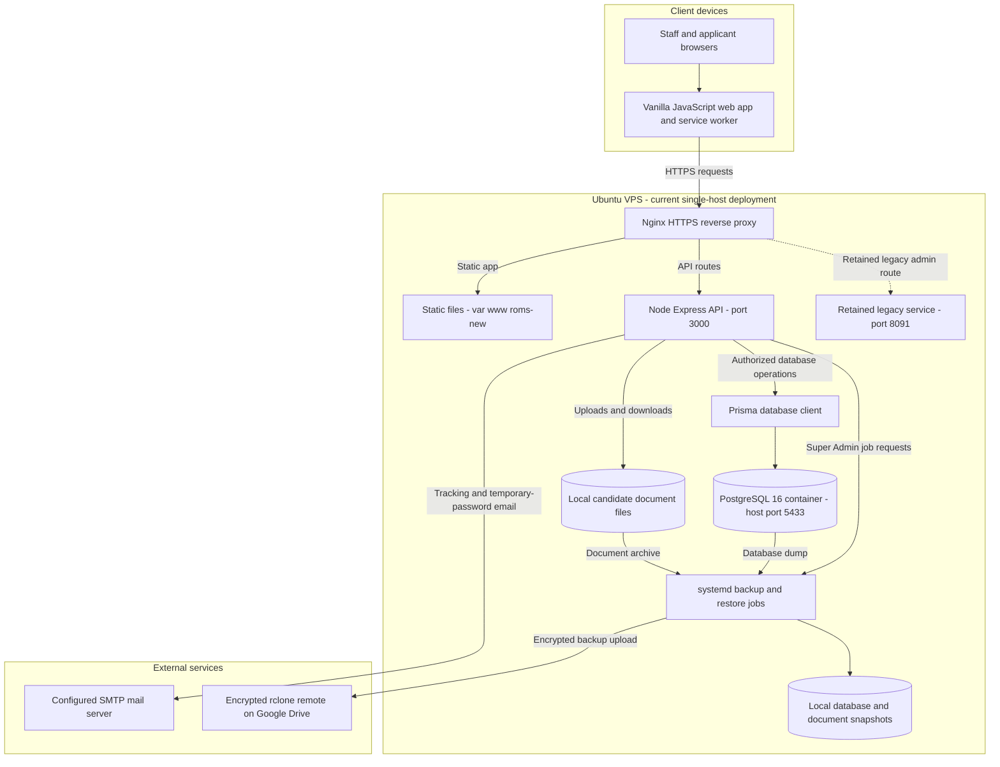
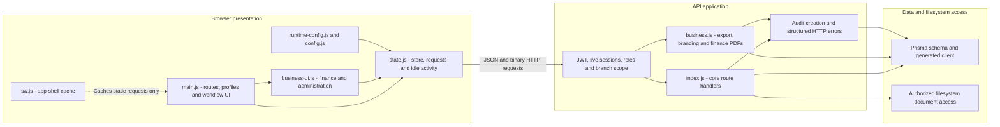

# ROMS Architecture Diagrams

Evidence: current source and read-only VPS inspection, 2026-10-05. These describe the existing application, not a proposed migration. See [the complete blueprint](../../../../../docs/system-blueprint.md) for permissions, workflows, operations and limitations.

## Application Architecture

<!-- mermaid-checked: no \n, no em-dash/en-dash, no {} in labels, subgraphs are id["label"], arrows are -->|"label"|, all subgraphs closed by end, ids unique -->

| Layer | Technology | Version Basis | Purpose |
|---|---|---|---|
| Browser UI | Native ES modules, HTML, CSS | Source | Hash-routed staff and public portals |
| Styling | Tailwind CSS, custom CSS | Tailwind 3.x manifest | Responsive forms, ledgers and modals |
| Icons/build | Lucide, esbuild | Manifest | Locally bundled icon module |
| HTTPS/proxy | Nginx | Live 1.24.0 on Ubuntu | Static files and reverse proxy |
| API | Node.js, Express | Live Node 18.19.1; Express 5.x manifest | Authorization and business workflows |
| ORM | Prisma | Generated client 6.19.3 in validation/deploy output | PostgreSQL queries and transactions |
| Database | PostgreSQL | Live container image postgres:16-alpine | Relational business records |
| Documents | PDFKit, pdf-lib, ExcelJS | Backend manifest | PDF generation/merge and XLSX export |
| Identity/mail | JWT, bcryptjs, Nodemailer | Backend manifest | Sign-in, password hashing and SMTP |
| Operations | systemd, Docker, rclone | Service files and live checks | Process supervision, database and backup jobs |

Database rows contain business metadata; candidate files live on the VPS filesystem. The logo is a validated PNG/JPEG data URL in CompanySettings. There is no Redis, message broker, distributed session store, or microservice fleet in the current new application. Backup jobs, rather than an application queue, perform remote archive transfers.

Architectural decisions: one API owns authorization and accounting; the browser never connects directly to PostgreSQL; file and database backups are paired; older PocketBase configuration and a legacy proxy remain but are not the new API data path. The live API/database ports are bound on all interfaces; firewall exposure is not asserted here.

## Component Relationships

<!-- mermaid-checked: no \n, no em-dash/en-dash, no {} in labels, subgraphs are id["label"], arrows are -->|"label"|, all subgraphs closed by end, ids unique -->

| Component | Ownership and Interaction |
|---|---|
| main.js | Dashboard, public application/tracking, profile dialogs, job and workflow controls; subscribes to store refreshes |
| business-ui.js | Ledger, statements, export chooser, task bell, user reports, company settings, passport summary/actions |
| state.js | In-memory token/user/data, authenticated fetch, normalization, refresh, activity timer and heartbeat |
| index.js | Express middleware; auth; users/branches/candidates/jobs/applications/documents/payments; backup controls |
| business.js | Company configuration, scoped export, passport deletion, payment void, financial document rendering and user activity report |
| schema.prisma | Ten persisted models, enums, foreign keys, uniqueness and indexes |
| systemd units/scripts | API lifecycle and backup/restore orchestration outside request processes |

Dependencies are explicit module imports and function parameters, not a dependency-injection framework. HTTP route authorization and SQL transaction boundaries are authoritative; hiding a button is not the security boundary.