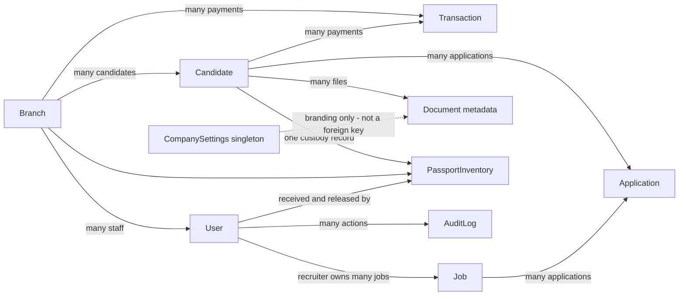
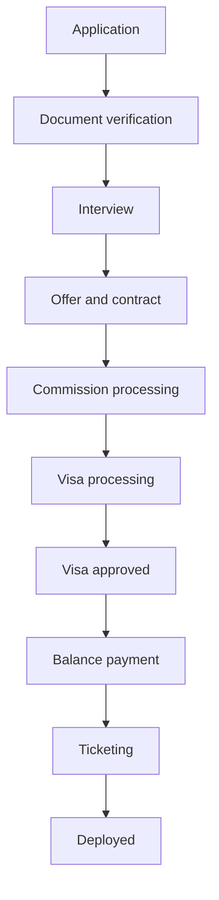

# ROMS System Blueprint

As of 2026-10-06. This is the implemented system, including employer-linked recruiter jobs, the read-only Branch Admin staff policy and expanded registration export. Runtime topology measurements were taken on 2026-10-05; employer ownership and permissions were subsequently validated against isolated PostgreSQL. Evidence comes from source, browser/API tests and read-only VPS configuration checks. Recommendations are separated from current behavior. No credentials or private tracking tokens are included.

## 1. System Purpose and Boundaries

ROMS manages overseas recruitment across branch offices: candidate registration, job applications, recruitment stages, document verification, physical passport custody, commission agreements, payments, finance documents, staff permissions, public progress tracking and operational backups.

It is a single web application with one Node API and one PostgreSQL database. It is not currently a full accounting ERP, a payroll platform, a distributed microservice system, or a fully offline recruitment database. Client branding is one company configuration for the installation, not a multi-tenant company-isolation model.

## 2. Architecture Diagrams

The [two-layer architecture diagrams](../.github/modernize/assessment/engines/facts/architecture-diagram.md) show the application topology and detailed component relationships. They include the retained legacy proxy as a separate component.

## 3. Verified Runtime Topology

| Surface | Current Implementation | Evidence/Caveat |
|---|---|---|
| Public URL | https://new.rabiyaroms.top | Runtime config and HTTPS checks |
| HTTPS | Nginx 1.24.0, port 443; port 80 redirects to HTTPS | Live vhost inspection; certificate directives managed by Certbot |
| Frontend | /var/www/roms-new | Nginx static root and deployment script |
| API | /opt/roms-api, roms-api.service, port 3000 | Live systemd and listener checks |
| API runtime | Node 18.19.1, root user/group | Live runtime facts, not the older least-privilege documentation example |
| Database | roms-postgres container, postgres:16-alpine, host 5433 to container 5432 | Live Docker inspection |
| Documents | Configured UPLOAD_DIR; defaults to ./uploads under API working directory | Source and backup defaults |
| Backup storage | /var/backups/roms plus encrypted rclone Drive remote | Scripts and successful backup service runs |
| Legacy admin route | /_/ proxied to 127.0.0.1:8091; listener exists | Live Nginx/listener check; separate from /api/ |

Important: API port 3000 and database port 5433 currently listen on all interfaces. Binding observations do not establish internet reachability; firewall/security-group policy was not audited. Other ROMS-named containers remain on ports 8080/8081, but they are not the new site's inspected static-root/API path.

## 4. Code and Ownership Map

| Area | Source | Responsibility |
|---|---|---|
| App shell | [index.html](../index.html), [styles.css](../styles.css), generated [tailwind.css](../tailwind.css) | Browser entry and responsive design |
| UI orchestration | [js/main.js](../js/main.js) | Hash routes, candidate tabs, forms, workflow actions |
| Business UI | [js/business-ui.js](../js/business-ui.js) | Finance, exports, notifications, reports and settings |
| Client state | [js/state.js](../js/state.js) | Requests, data refresh, session activity and normalization |
| Runtime endpoint | [js/runtime-config.js](../js/runtime-config.js), [js/config.js](../js/config.js) | API base URL; a PocketBase constant remains as legacy configuration |
| Static cache | [sw.js](../sw.js) | Network-first static shell cache; excludes /api/ |
| Core API | [server/src/index.js](../server/src/index.js) | Express routes, auth, scope, state transitions and upload/backup operations |
| Business API | [server/src/business.js](../server/src/business.js) | Export fields, settings, voids, passport deletion and financial PDFs |
| Employer access policy | [server/src/recruiter-access.js](../server/src/recruiter-access.js) | Job-owned candidate scope and finance-safe response field selections |
| Persistence | [server/prisma/schema.prisma](../server/prisma/schema.prisma) | Tables, relations, enums, constraints and indexes |
| Operations | [deploy-backend.ps1](../deploy-backend.ps1), [deploy-frontend.ps1](../deploy-frontend.ps1), [deploy-all.ps1](../deploy-all.ps1) | SSH/SCP build and deployment |
| Tests | [server/src/business.test.js](../server/src/business.test.js), [tests/business.spec.cjs](../tests/business.spec.cjs), [server/src/validate-postgres.js](../server/src/validate-postgres.js) | API/PDF fixtures, actual browser flows and disposable-schema integration |

The application uses native browser ES modules; React, Angular and Vue are not part of the current stack. Tailwind 3 and custom CSS provide styling. Lucide icons are bundled locally with esbuild. The backend uses Express 5, Prisma 6, bcryptjs, JWT, Nodemailer, PDFKit, pdf-lib and ExcelJS. Earlier PocketBase documentation is historical, not the authority for current API behavior.

## 5. Data Model

| Model | Main Data | Relations and Constraints |
|---|---|---|
| Branch | Name, unique code, accent, tracking sequence | One-to-many users, candidates, payments and passport records; unique name/code |
| User | Username, email, password hash, role, active/reset flags, token version | Optional branch and optional legacy candidate relation; unique username/email; audit/custody actor references |
| Candidate | Split name, DOB, gender, marital status, measurements, identification, contact/registration information | Required branch; unique passport, tracking number and public tracking token; applications/documents/payments/custody |
| Candidate financial/workflow fields | Agreed commission, fee parts, office fee, paid amount, verification/interview/offer flags, stage | Financial amounts use PostgreSQL Decimal; business transitions validated by API |
| Job | Unique reference, title/type, employer snapshot, recruiterId, destination, headcount, salary, duration, skills, status | Optional foreign key to recruiter User; indexed owner ID; deletion restricts linked user removal; linked applications |
| Application | Candidate/job IDs, shortlist/interview/selection status | Unique candidate/job pair |
| Transaction | Candidate/branch, category, original amount/currency/rate, KES amount, method/reference/status | Voided flag/time/actor retained; candidate can be nullable for legacy records |
| Document | Candidate, type, file name/path, MIME type | File bytes live outside database; candidate relation cascades metadata deletion |
| PassportInventory | Candidate/branch, custody status/location/notes, received/released timestamps and users | One custody record per candidate; actor references to User |
| AuditLog | Actor or retained actor identity, action, entity, entity ID, JSON metadata, timestamp | Actor deletion keeps historical identity; API UI reads latest 500 entries |
| CompanySettings | Company name/logo, email, phones, address, website, registration and tax numbers | Application uses singleton id company; no tenant foreign keys |

The candidate's two authentication-like tracking identifiers have different purposes: the short tracking number supports number-plus-email lookup; the private token authorizes public-link tracking. Private tokens and password hashes are deliberately excluded from Excel.

<!-- mermaid-checked: no \n, no em-dash/en-dash, no {} in labels, subgraphs are id["label"], arrows are -->|"label"|, all subgraphs closed by end, ids unique -->

## 6. Staff Permissions

Read/write scope is enforced by API roles and candidate/branch predicates, not solely by UI controls.

| Role | Scope and Key Capabilities |
|---|---|
| Super Admin | Global administration, user CRUD/reset, branch CRUD, candidate deletion, job approval/deletion, finance approval/void, company settings, audit and backups |
| Super Finance | Global candidate/finance data, payment recording/approval/void, financial PDFs, exports; no staff/branch administration |
| Branch Admin | Own branch candidate/custody/finance data; registration, candidate updates, passport deletion, global job submission/approval; own branch staff list/report are read-only; cannot add/edit/delete/reset any user |
| Branch Finance | Own branch financial/candidate data, payment recording/approval, receipts/statements/export; no voiding or user administration |
| Branch Staff | Own branch registrations, workflow/documents and passport handling; can record pending payments; no finance approval/void or user management |
| Recruiter | Employer account: create own jobs; see own jobs and their assigned candidates/applications/documents; read-only applicant access; no candidate/workflow mutations, financial data, financial PDFs or workbook exports |
| Public applicant | Open-job browsing, branch choice, application submission and private progress tracking; no staff session |

The legacy candidate role remains in the database enum, but current staff authentication rejects it. Applicants use the public portal instead. All staff may change their own password through the existing authenticated password-change flow; the read-only user policy forbids administering or resetting other accounts, not normal self-service password changes.

Super Admin and Branch Admin can create recruiter/employer system users through the dedicated Recruiters page. Branch Admin-created recruiter accounts are restricted to their branch and role Recruiter. This does not permit general staff account creation/edit/reset. A job's recruiterId, not its display employer name, governs access. Existing unassigned jobs remain admin-visible and must be explicitly linked; there is no guessed ownership migration. Employer-facing APIs use field allowlists and application ownership filters, including document checks. The separate public job portal continues to show open positions.

## 7. Recruitment Workflow

<!-- mermaid-checked: no \n, no em-dash/en-dash, no {} in labels, subgraphs are id["label"], arrows are -->|"label"|, all subgraphs closed by end, ids unique -->

The API prevents backwards movement and advancing more than one stage at a time. Document verification requires recorded physical passport receipt; interview advancement requires verified documents; the offer stage requires an interview date and Passed outcome; commission processing requires the signed offer; ticketing requires paid amount to cover the agreement. Legacy stage values are mapped for compatibility.

Public registration checks required fields, an open job and an existing branch. A database transaction allocates a branch tracking sequence, creates the candidate/application, and updates the job's filled counter. SMTP tracking email is attempted after the database transaction; mail failure does not discard a successfully registered candidate. Staff registration also allocates a branch tracking number and can link a chosen job.

Job submissions start Pending_approval. Super Admin or Branch Admin approval publishes an Open job unless its counters mark it Filled. Reference allocation retries occupied references. This is not a permanent independent reference-sequence table, and retries are bounded.

## 8. Finance and Document Rules

- Agreement amount is the candidate's Commission Total; Agreed Fee is kept synchronized by the update API.
- Office fee equals Commission Total minus visa, medical, foreign-affairs attestation, KMPDU medical, embassy attestation and ticket costs. Negative values are rejected.
- Original transaction currency, exchange rate and converted KES amount are stored. Paid totals use the stored KES amount.
- Receipt adds to paid amount, Refund subtracts, and Other requires a description but does not change commission balance. Legacy Candidate fee/Agency commission are treated as receipt-like entries.
- New entries await approval. Approval and void operations use database transactions/conditional updates so concurrent requests do not count a payment twice.
- Only Super Admin/Super Finance can void an approved active payment. Voiding reverses its effect and retains its visible struck-through history. A refund-dependent receipt cannot be voided if that would make paid totals negative.
- Approved or voided payments cannot be permanently deleted or changed back to pending. Pending entries retain the existing Super Admin deletion path.
- Statements begin with the agreement, show debit/credit/running balance and retain excluded pending/rejected/voided rows. Historical opening paid amounts reconcile legacy balances without silently rewriting history.
- Receipt PDFs require approved non-voided entries. Receipt serials use RCT plus the immutable payment ID; statement serials use STM plus candidate ID. A regenerated statement is current information, not a stored historical snapshot.
- PDFs use server-side company branding, repeated statement headings and numbered footers. Previously printed/downloaded documents cannot be recalled after a void.
- Agreement summaries count candidates with a positive commission; branch reports use branch-scoped data. Expenses are not yet implemented. This is not a double-entry general ledger or bank reconciliation system.

## 9. Document and Passport Workflows

Registration documents are uploaded as base64 JSON with a 10MB decoded limit. Scanned JPEG/PNG pages are combined as PDF. Sensitive document downloads check authentication, candidate scope and filesystem paths. File metadata is stored in PostgreSQL, file content under UPLOAD_DIR. Selected document combination respects the requested order and accepts 2-20 different documents.

Passport custody tracks In storage, Released to candidate, Released to embassy and Returned to office. Deletion is allowed to Super Admin or the owning Branch Admin and clears the candidate physical-received flag, preventing automatic record recreation. The top count includes all visible retained custody records, with in-office/released subtotals; it is not a lifetime count including deleted records. Search does not change the overall inventory count.

## 10. Excel, Reports and Notifications

Candidate XLSX exports capture the currently visible stage/search/branch-filtered rows. Users choose and arrange columns; the server independently applies branch scope. Registration fields include split names, DOB, gender, marital status, measurements, passport/expiry, national ID/nationality, contact/address and registration/sub-agent details. Financial, workflow and document-count fields are selectable as well. Dates are formatted consistently; identifiers and formula-like text remain strings.

User reports count current staff and rank all-time audit activity, globally or in the visible branch. Notifications are computed from current store data: new applications, pending job approvals and pending payments, filtered by role/scope. They are not a persisted inbox, WebSocket feed or push-notification service. Refresh retrieves updated tasks; payment tasks can open the candidate statement.

## 11. HTTP API Blueprint

All API paths below are prefixed /api. See the core and business source files for individual field validation.

| Group | Main Routes | Authorization |
|---|---|---|
| Health/public configuration | GET /health, /public/company, /public/jobs, /public/branches | Public |
| Applicant registration | POST /public/applications | Public, required-field checks and connection rate limit |
| Applicant tracking | POST /public/track, /public/track/link, /public/track/link/email, /public/track/link/receipt.pdf | Number/email or private token; applicable rate limits |
| Staff identity | POST /auth/login, /auth/first-password, /auth/password/change, /auth/logout; GET /auth/me | Login public; other identity routes authenticated |
| Staff accounts | GET/POST /users; PATCH/DELETE /users/:id; POST /users/:id/reset-password | Read own-branch users for Branch Admin; all mutations Super Admin |
| Recruiter accounts | GET/POST /recruiters | Authenticated directory in role/branch scope; creation Super Admin/Branch Admin, fixed recruiter role |
| Activity report | GET /users/report, GET /audit | User report Super Admin/Branch Admin; audit Super Admin |
| Branches | GET/POST /branches; PATCH/DELETE /branches/:id | Scoped reading; mutations Super Admin |
| Candidates | GET/POST /candidates; PATCH/DELETE /candidates/:id | Candidate/role scope; deletion Super Admin |
| Excel | POST /candidates/export | Authorized agency staff only, not recruiters; export whitelist and independent branch scope |
| Jobs | GET/POST /jobs; PATCH/DELETE /jobs/:id; PATCH /jobs/:id/approve | Global pool; approval/edit Super Admin/Branch Admin; deletion Super Admin |
| Applications | GET/POST /applications | Candidate/branch scope; allowed recruitment staff for creation |
| Candidate files | POST /candidates/:id/documents, /candidates/:id/documents/scan, /candidates/:id/documents/combined; GET/DELETE /documents/:id | Authenticated candidate/file scope; creation/deletion role guards |
| Passport inventory | GET/POST /passports; PATCH/DELETE /passports/:id | Role/branch scope; deletion Super Admin/Branch Admin |
| Payments | GET/POST /transactions; PATCH/DELETE /transactions/:id; POST /transactions/:id/void | Financial/branch scope; approval finance roles; void global finance/admin |
| Financial PDFs | GET /candidates/:id/statement.pdf, /transactions/:id/receipt.pdf | Finance roles with candidate scope; active approved receipt constraint |
| Company branding | GET/PUT /company | Staff reading; Super Admin editing |
| Recovery jobs | GET/POST /admin/backups; GET /admin/backups/status; POST /admin/backups/restore | Super Admin only |

The API returns JSON for ordinary data, blobs for downloads, and standard 400/401/403/404/409/413/429/500-class responses for validation, auth, scope, conflicts, sizes, limits and failures. The global handler hides ordinary database/internal messages; concurrent payment changes get a meaningful 409.

## 12. Authentication, Sessions and Security Boundaries

Passwords are bcrypt hashes. JWTs contain user ID, token version and a session ID, with an eight-hour token expiry. The server also checks the live in-memory session, role, active account, token version and ten-minute inactivity limit. Logout revokes that session; password reset/change increments token version.

The browser keeps the token in memory, not persistently in local storage. User activity includes keyboard/pointer/input/wheel/nested-scroll events. Thirty-second heartbeats keep an active browser session registered with the API but do not reset the browser inactivity timer. API restarts clear sessions and require sign-in; token/password resets may also require sign-in independently of inactivity. One-time passwords expire after 24 hours and require email confirmation plus replacement.

Express uses Helmet, configured CORS, a 35MB JSON body limit and trusted-proxy handling. Uploads use path checks and decoded-size/MIME validation; Nginx's deployed upload allowance is 20MB. Rate counters are process-local maps. TLS and role guards do not replace network/firewall or filesystem hardening.

## 13. Deployment and Recovery

The PowerShell scripts use OpenSSH key-based BatchMode SSH/SCP. Frontend deployment builds local icons/CSS and uploads static assets. Backend deployment uploads source/manifests/schema while preserving .env and documents, runs npm ci, generates Prisma Client, uses prisma db push, installs/reloads the systemd service, restarts API, checks Nginx and retries /api/health.

Current feature rollouts deploy the backend before the frontend when new endpoints are involved. deploy-all.ps1 itself runs frontend first; it should not be assumed to provide an atomic release. There is no blue/green deployment, database migration ledger, automatic rollback, or Git-based release artifact in these scripts.

Backups run daily at 02:00 Africa/Nairobi, with up to five minutes randomized delay and catch-up after downtime. A lock prevents overlapping backup/restore jobs. Each snapshot pairs a PostgreSQL custom dump with an uploads archive, retained locally for 14 days and on the configured encrypted Drive remote for 90 days. Private rclone credentials/crypt keys are outside app documents and must be recoverable separately.

Restore validates the selected paired archives, creates a pre-restore copy, stops the API, restores the database and uploads, restarts the API and checks health. Configured company settings are included in the database backup. These archives do not by themselves include deployed source, server .env, TLS material or rclone credentials; retain those separately for full host reconstruction.

## 14. Configuration Inventory

| Configuration | Purpose |
|---|---|
| DATABASE_URL | PostgreSQL connection and schema; secret |
| JWT_SECRET | JWT signing secret |
| PORT, UPLOAD_DIR | API listener and document storage location |
| CORS_ORIGIN, PUBLIC_APP_URL | Browser origin policy and public tracking links |
| SMTP_HOST/PORT/SECURE/USER/PASS, MAIL_FROM | SMTP transport and sender; credentials secret |
| RCLONE_REMOTE, RCLONE_CONFIG | Backup destination/config; API can read /etc/roms-backup.env defaults |
| POSTGRES_CONTAINER, BACKUP_DIR, UPLOADS_DIR | Backup script targets |
| LOCAL_RETENTION_DAYS, REMOTE_RETENTION_DAYS | Archive retention |
| window.ROMS_CONFIG.apiUrl | Frontend API base address |

## 15. Known Limitations and Hardening Priorities

These findings are documented, not silently fixed by the export/permission update:

1. Node 18 is out of support; upgrade it in a separately tested runtime change.
2. API and PostgreSQL ports bind to all interfaces. Verify firewall policy and plan loopback/private bindings, especially the database's Docker-published port.
3. The API service currently runs as root to invoke operational jobs. Separate application and narrowly privileged recovery controls before reducing privileges; simply changing User would break workflows.
4. Legacy /_/ remains reachable through Nginx and has an 8091 listener. Review authentication and retire it only after confirming it is unused.
5. Existing Tailwind/Prisma/Nodemailer advisories remain. The new Excel dependency's uuid advisory was patched; see the existing dependency report and workflow guide.
6. Authentication/rate state is process-local; API restart invalidates sessions. Horizontal replicas need shared session/rate state, shared file storage and coordinated job execution.
7. Backup restore initiation contains an _req reference inside a req-named handler. The systemd job is started before that reference, so its HTTP result/audit flow needs a focused fix and restore drill before relying on UI restore feedback.
8. The Node public profile-picture /uploads path is outside /api, while the inspected Nginx vhost only forwards /api and legacy /_/. Confirm profile-picture routing separately; private document downloads use the authorized API route.
9. The service worker has static-shell caching, not offline business-data synchronization. New modules are network-cached when fetched; they are not all in the install precache list.
10. There is no tested high-availability failover, formal RPO/RTO target, payment gateway, expense module, immutable statement archive or complete general ledger.

## 16. Verification and Future Blueprint

`npm test` currently runs ten API/PDF checks and eleven browser flows. The isolated PostgreSQL runner validates real concurrent approval/void operations, role scope, user read-only policy, export, branded PDFs, recruiter ownership and financial redaction in a disposable schema, then removes it. Native PDF visual review uses headed Chrome because headless Chrome may not paint its built-in viewer. Production verification is read-only health/asset checks, not test writes to live tables.

Recommended future work, not implemented: private DB/API bindings, supported Node runtime, least-privilege operational separation, dependency remediation, versioned migrations and atomic releases, documented recovery drills, persisted audit-aware expense accounting, and optional shared session/storage infrastructure if multiple API instances are introduced. Preserve branch scope, payment idempotency, private file authorization and existing tracking links during any such work.